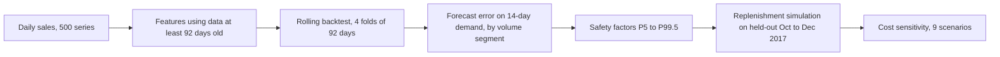
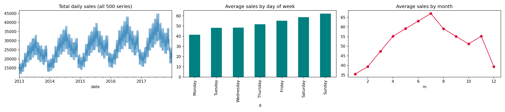
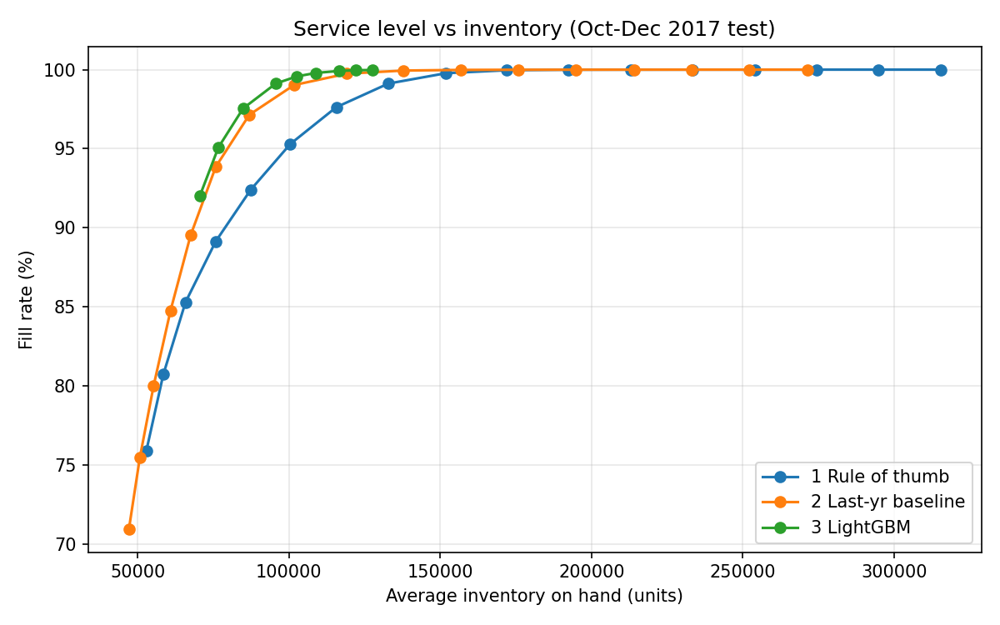

# Demand Forecasting and Inventory Optimisation

*Forecast daily demand for 500 store-item series, size safety stock from measured forecast error, and test in simulation whether a forecast-driven replenishment policy beats the rules most small distributors use.*

**Author:** YOUR NAME  |  **Stack:** Python, pandas, LightGBM, NumPy  |  **Type:** end-to-end analytics case study with business requirements

[One-page executive summary](docs/executive_summary.md) | [BRD](docs/BRD.md) | [User stories](docs/user_stories.md) | [KPIs](docs/kpis.md) | [Process flow](docs/process_flow.md) | [Traceability](docs/traceability_matrix.md)

## TL;DR

| Question | Result |
|---|---|
| How accurate is the forecast? | **10.8% WAPE** across 4 rolling backtest folds, vs 15.2% for the best baseline. Bias +0.06%. |
| How much less stock for the same service? | **26.7%-29.5% less inventory** than a 28-day rule of thumb at 98%-99.5% fill rate. **6.0%-10.4% less** than a seasonal baseline. |
| What does it do to cost? | **-27.9%** vs the rule of thumb and **-12.7%** vs the seasonal baseline (base cost assumptions). |
| Does it depend on my cost assumptions? | No. The model is cheapest in all 9 holding-cost and lost-margin scenarios (-26.9% to -28.4% vs rule of thumb). |

**Where the 27.9% comes from:** 17.4 points come from using any seasonal forecast at all. The machine-learning model adds the remaining 10.5 points. A simple seasonal baseline captures most of the easy gain, and the model's contribution is real but smaller.

**How far to trust it:** one test season (78 evaluated days), assumed costs and lead time, and an unusually regular public dataset. See [Confidence and limitations](#6-confidence-and-limitations).

## 1. Business Problem

A multi-store distributor (hypothetical framing; the data is a public Kaggle dataset) carries 50 items in each of 10 stores. Stock too low and sales are lost. Stock too high and cash is tied up. The weekly question is how much to order.

The assumed current practice is a rule of thumb: hold about 14 days of the last 28 days' average sales. It ignores weekly and yearly seasonality and has no explicit buffer. The questions this project answers:

1. Can a forecast beat that rule, and by how much?
2. How large a buffer does the forecast error actually justify?
3. What does that mean in inventory and cost, and how sure can we be?

## 2. Approach



## 3. Data

Kaggle [Store Item Demand Forecasting Challenge](https://www.kaggle.com/c/demand-forecasting-kernels-only/data): daily unit sales by `date`, `store`, `item`.

| Property | Value |
|---|---|
| Rows | 913,000 |
| Series | 500 (10 stores x 50 items) |
| Period | 2013-01-01 to 2017-12-31 (1,826 days per series) |
| Missing values | 0 |
| Zero-sales rows | 1 |
| Daily sales per series | mean 52.3, median 47, max 231 |

Not in the data: prices, costs, lead times, inventory levels, promotions. These are assumptions (see the [BRD](docs/BRD.md)). Demand is unusually smooth, so results may not carry over to messier retail data.

Patterns that shaped the model (read from the charts, approximate): Sunday sales run about 50% above Monday, July about 88% above January, and total sales trend upward year on year.



## 4. Findings

### 4.1 Forecast accuracy

Rolling-origin validation: each fold trains only on data before its window and forecasts the next 92 days (fold starts 2016-10-01, 2017-01-01, 2017-04-01, 2017-07-01).

| Model | WAPE | Bias | MASE |
|---|---|---|---|
| Weekday profile (last 4 weeks) | 17.96% | -2.59% | 1.248 |
| Last year x growth | 15.17% | +1.20% | 1.076 |
| **LightGBM** | **10.78%** | **+0.06%** | **0.767** |

LightGBM beat both baselines in all four folds (WAPE 11.4%, 12.0%, 9.9%, 9.9%). The weekday profile swings from +13.6% to -20.2% bias when the season turns; last year x growth is steadier. MASE is scaled by an in-sample one-step weekly naive error while these are 92-day-ahead forecasts, so WAPE is the headline metric.

### 4.2 Forecast uncertainty

Daily WAPE is 9.9%-12.0%, but error on 14-day cumulative demand (7-day lead time plus weekly review) is **3.1%-4.0%**, because daily noise averages out over the window.

Extra stock above the 14-day forecast needed to cover each level, estimated from backtests only:

| Segment | P90 | P95 | P98 | P99 |
|---|---|---|---|---|
| Low volume (167 series) | 7.7% | 10.2% | 13.1% | 15.2% |
| Mid volume (166 series) | 5.5% | 7.2% | 9.2% | 10.6% |
| High volume (167 series) | 5.2% | 6.8% | 8.6% | 10.0% |

Low-volume items need the largest buffer because small counts are proportionally noisier. The 14-day windows overlap and share common shocks, so the tail estimates are less reliable than the middle ones.

### 4.3 Replenishment simulation

Held-out period: forecasts made on 2017-10-01; metrics cover Oct 15-Dec 31 2017 (78 days, after a 14-day warm-up). Weekly order-up-to policy, 7-day lead time, unmet demand lost.

**Fixed fill rate (the fair comparison).** Average inventory needed to reach each target, read off each policy's full trade-off curve:

| Fill rate | Rule of thumb | Seasonal baseline | LightGBM | Less vs rule | Less vs baseline |
|---|---|---|---|---|---|
| 98% | 119,928 | 93,582 | 87,928 | 26.7% | 6.0% |
| 99% | 131,448 | 101,446 | 94,787 | 27.9% | 6.6% |
| 99.5% | 143,874 | 113,164 | 101,428 | 29.5% | 10.4% |

**Lowest-cost setting of each policy** (settings chosen on this period; see limitation 1):

| Policy | Setting | Fill rate | Stockout rate | Avg inventory (units) | Cost |
|---|---|---|---|---|---|
| 1 Rule of thumb | +15% buffer | 99.96% | 0.17% | 171,971 | $95,097 |
| 2 Seasonal baseline | +15% buffer | 99.94% | 0.32% | 137,791 | $78,532 |
| 3 LightGBM + safety stock | P99 | 99.96% | 0.19% | 122,145 | $68,528 |



### 4.4 Cost sensitivity

Cost inputs are placeholders, so the comparison was re-run for holding rate 15%/25%/40% a year and lost margin $2/$4/$8 per unit:

| Hold % | Lost $ | Rule | Baseline | LightGBM | vs rule | vs baseline | Best setting |
|---|---|---|---|---|---|---|---|
| 15 | 2 | 56,736 | 46,628 | 40,789 | -28.1% | -12.5% | P99 |
| 15 | 4 | 58,347 | 49,087 | 42,425 | -27.3% | -13.6% | P99 |
| 15 | 8 | 61,570 | 53,237 | 44,220 | -28.2% | -16.9% | P99.5 |
| 25 | 2 | 90,607 | 74,355 | 65,712 | -27.5% | -11.6% | P98 |
| 25 | 4 | 95,097 | 78,532 | 68,528 | -27.9% | -12.7% | P99 |
| 25 | 8 | 98,320 | 83,451 | 71,499 | -27.3% | -14.3% | P99.5 |
| 40 | 2 | 139,291 | 112,548 | 101,886 | -26.9% | -9.5% | P95 |
| 40 | 4 | 148,756 | 122,701 | 106,539 | -28.4% | -13.2% | P98 |
| 40 | 8 | 153,444 | 127,619 | 110,953 | -27.7% | -13.1% | P99 |

The ranking never changes. The best service level falls when holding is expensive or a lost sale is cheap, as it should.

## 5. Recommendation

1. **Replace the rule of thumb with a forecast-driven order-up-to level:** `S = 14-day forecast x (1 + safety factor by volume segment)`; order `S - (on hand + on order)`.
2. **Start at P98-P99** and set the final service level once the real cost of a lost sale and of holding stock is known (the sensitivity table shows the range).
3. **Take the cheap gain first.** The seasonal baseline alone delivers 17.4 of the 27.9 points and is simpler to run and explain. Keep it as the fallback.
4. **Pilot before rollout:** shadow mode, then a matched-control pilot with go/no-go gates. See the [executive summary](docs/executive_summary.md) and [BRD](docs/BRD.md#12-implementation-approach).
5. **Monitor weekly** against the [KPI framework](docs/kpis.md), with automatic fallback to the baseline if the model degrades.

## 6. Confidence and Limitations

Ranked by how much they could change the conclusion:

1. **Settings were chosen on the test period.** For all three policies, the "lowest-cost setting" (buffer for the comparators, service level for the model) was picked using the Oct-Dec 2017 results, so absolute costs are optimistic for every policy. The fixed-fill-rate comparison in 4.3 does not rely on this, because it reads each policy off its whole curve. A stricter design would choose settings on a backtest fold and report the test period once (listed under next steps).
2. **One test season.** 78 evaluated days; no confidence intervals. The gain could differ in other seasons.
3. **Assumed economics.** Unit cost $10, holding 25% a year, $4 lost margin, 7-day lead time, weekly ordering. The cost inputs are stress-tested (4.4); lead time is not.
4. **Simplified inventory model.** Lost sales (no backorders), no order cost, minimum order quantity, shelf life or lead-time variability; all 500 series weighted equally. Sales are treated as demand, although past stockouts would hide demand in real data.
5. **Conservative for the model.** Forecasts were made once with inputs at least 92 days old, while the rule of thumb sees fresh sales every day. A weekly refresh would likely help the model; not tested.
6. **Regular data.** Only one zero-sales row in 913,000. Real retail has promotions, new items and noise.
7. **Comparator choice.** The rule of thumb is deliberately simple; the seasonal baseline is included as a fairer yardstick.

## 7. Next Steps

- Choose settings on a validation fold and report the test period once.
- Weekly re-forecasting with a shorter horizon, compared with the quarterly forecast used here.
- Bootstrap confidence intervals on the cost and inventory differences.
- Lead-time variability, order costs and minimum order quantities in the simulation.
- Quantile models for prediction intervals, compared with the empirical safety factors.

## 8. Skills Demonstrated

Time-series validation without leakage | global gradient-boosting forecasting | error-based safety stock | discrete-event style inventory simulation | cost sensitivity analysis | requirements writing (BRD, user stories, traceability) | KPI design | stating limitations plainly

## 9. Repository Map

```
01_Inventory_Optimisation_Supply_Chain/
  README.md
  docs/        executive_summary, BRD, user_stories, kpis, process_flow, traceability_matrix
  notebooks/   demand_forecasting.ipynb
  images/      demand_eda.png, frontier.png
  data/        baseline_results.csv, lgbm_results.csv, safety_factors.csv,
               simulation_results.csv, cost_sensitivity.csv   (raw data not committed)
```

## 10. Reproduce

1. Download `train.csv` from the Kaggle link in section 3 (join the competition first).
2. Open `notebooks/demand_forecasting.ipynb` in Google Colab, upload `train.csv`, and run the cells in order (roughly 30 minutes in total).

## Appendix: Technical Details

- **Metrics:** WAPE = sum of absolute errors / sum of actuals. Bias = (forecast - actual) / actual, summed. MASE = mean absolute error / in-sample lag-7 naive error, averaged over series. Fill rate = 1 - lost units / demand units.
- **Model:** LightGBM, Poisson objective, 400 trees, learning rate 0.05, 63 leaves, min 50 samples per leaf, 80% row and column sampling, seed 42, no tuning.
- **Features** (all from at least 92 days before the target date): day of week, month, day of month, week of year, day of year, store, item, same weekday last year, centred 7-day mean last year, trailing 91-day mean, the same mean a year earlier, and their ratio.
- **Safety factor:** quantile of (actual - forecast) / forecast for rolling 14-day sums, pooled over 4 backtest folds, by volume tercile (terciles from sales before 2016-10-01).
- **Policy:** review every 7 days, lead time 7 days, `S = 14-day forecast x (1 + factor)`, order = max(0, S - inventory position), 14-day warm-up excluded.
- **Cost:** holding $10 x rate / 365 per unit-day; lost sale $4 per unit (base case).
