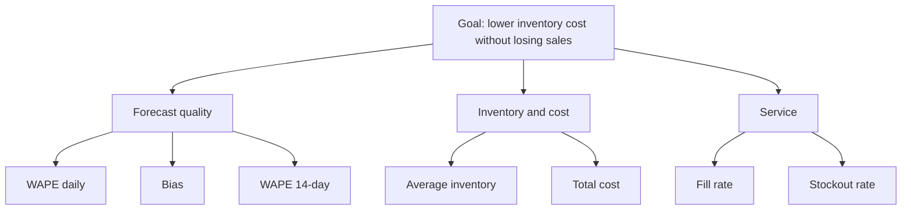

# KPI Framework: Demand Forecasting and Inventory Optimisation

Test results come from the 4-fold rolling backtest and the Oct 15-Dec 31 2017 simulation (base cost assumptions). Targets and thresholds are proposed and should be agreed with the business.

## KPI Tree

**Guardrail:** an inventory reduction only counts if fill rate stays at 99% or higher. Never trade availability for stock.

## Definitions

| KPI | Formula | Why it matters | Owner | Frequency |
|---|---|---|---|---|
| WAPE (daily) | Sum of absolute (forecast - actual) / sum of actual, store-item-day | Overall forecast accuracy | Data Analyst | Weekly |
| Bias | Sum of (forecast - actual) / sum of actual | Systematic over- or under-forecasting turns into overstock or stockouts | Data Analyst | Weekly |
| WAPE (14-day) | Same, on rolling 14-day sums | The error that matters for ordering | Data Analyst | Weekly |
| Fill rate | 1 - lost units / demanded units | Availability | Ops Manager | Weekly |
| Stockout rate | Store-item-days with any lost sale / store-item-days | How often shelves are empty | Ops Manager | Weekly |
| Average inventory | Mean over days of total units on hand | Cash tied up | Finance Head | Weekly |
| Total cost | Holding cost + lost margin | Single trade-off number | Finance Head | Monthly |

## Performance and Thresholds

| KPI | Benchmark (rule of thumb or baseline) | Test result | Target | Green | Amber | Red |
|---|---|---|---|---|---|---|
| WAPE (daily) | 15.17% (seasonal baseline) | 10.78% | 12% or lower | 12% or lower | 12%-15.2% | above 15.2% (worse than baseline) |
| Bias | +1.20% (seasonal baseline) | +0.06% | within +/-2% | within +/-2% | +/-2% to +/-5% | beyond +/-5% |
| WAPE (14-day) | not measured for baseline | 3.1%-4.0% | 5% or lower | 5% or lower | 5%-7% | above 7% |
| Fill rate | 99.96% (rule of thumb) | 99.96% | 99% or higher | 99% or higher | 98%-99% | below 98% |
| Stockout rate | 0.17% (rule of thumb) | 0.19% | 0.5% or lower | 0.5% or lower | 0.5%-1% | above 1% |
| Average inventory | 171,971 units | 122,145 units | 20% or more below benchmark | 20% or more below | 10%-20% below | less than 10% below |
| Total cost | $95,097 | $68,528 | Below benchmark | 20% or more below | 10%-20% below | less than 10% below |

## Safety Factors by Segment (extra stock above the 14-day forecast)

| Segment | Series | P90 | P95 | P98 | P99 |
|---|---|---|---|---|---|
| Low volume | 167 | 7.7% | 10.2% | 13.1% | 15.2% |
| Mid volume | 166 | 5.5% | 7.2% | 9.2% | 10.6% |
| High volume | 167 | 5.2% | 6.8% | 8.6% | 10.0% |

## Supporting Results

- **Inventory needed for a target fill rate** (rule of thumb / seasonal baseline / model): 98% = 119,928 / 93,582 / 87,928; 99% = 131,448 / 101,446 / 94,787; 99.5% = 143,874 / 113,164 / 101,428.
- **Cost sensitivity:** model is 26.9%-28.4% cheaper than the rule of thumb and 9.5%-16.9% cheaper than the seasonal baseline across 9 scenarios.
- **Where the saving comes from:** 17.4 of 27.9 points from any seasonal forecast, 10.5 from the model.

## Notes

- Costs ($10 unit, 25% holding, $4 lost margin) and the 7-day lead time are assumptions.
- One test period of 78 evaluated days; thresholds are proposals, not outcomes.
- At the cost-optimal settings all fill rates are 99.9% or higher, so average inventory is the more informative comparison.
