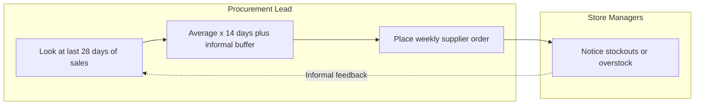
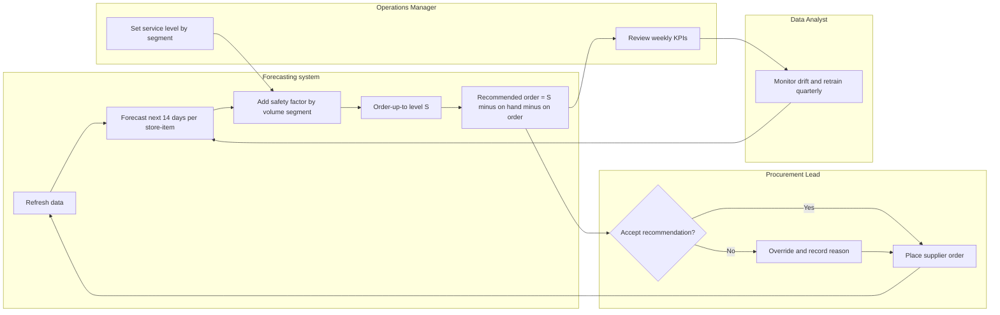
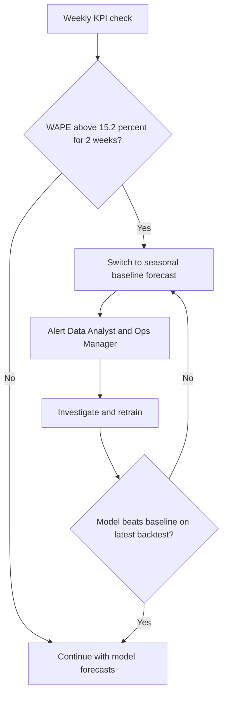

# Process Flow: Demand Forecasting and Inventory Optimisation

Roles and steps are hypothetical and describe how the policy would run, not an existing system. Links: [BRD](BRD.md) | [User stories](user_stories.md) | [KPIs](kpis.md)

## 1. As-Is (rule of thumb)

**Pain points**
- The trailing average lags seasonal swings (weekly and yearly).
- The buffer is a guess; the rule needed a +15% buffer to stay available in simulation.
- Feedback from stores is informal, so errors repeat.
- Result in simulation: 171,971 units on hand on average.

## 2. To-Be (forecast-driven replenishment)

## 3. Exception Flow: Model Degrades

## 4. Decision Rules

| Decision | Rule | Owner |
|---|---|---|
| Order quantity | max(0, S - on hand - on order) | System |
| Order-up-to level S | 14-day forecast x (1 + segment safety factor) | System |
| Safety factor | Backtest quantile of 14-day forecast error for the volume segment at the chosen service level | Ops Manager sets level |
| Starting service level | P98-P99 at base costs; lower if holding is expensive or a lost sale is cheap | Ops Manager, Finance Head |
| Override | Allowed, with a recorded reason | Procurement Lead |
| Fallback | Seasonal baseline if WAPE above 15.2% for 2 weeks | Data Analyst |
| Retrain | Quarterly, re-validated on rolling origins | Data Analyst |

## 5. Responsibilities (RACI)

R = does the work, A = accountable, C = consulted, I = informed.

| Activity | Procurement Lead | Ops Manager | Finance Head | Data Analyst |
|---|---|---|---|---|
| Refresh forecast and recommendations | I | A | I | R |
| Review and place orders | R | A | I | C |
| Override a recommendation | R | A | I | I |
| Set service level by segment | C | R | A | C |
| Review weekly KPIs | I | A | C | R |
| Retrain and re-validate | I | A | C | R |

## 6. Expected Impact (simulation, Oct 15-Dec 31 2017, base assumptions)

- 26.7%-29.5% less average inventory than the rule of thumb at 98%-99.5% fill rate
- 27.9% lower total cost than the rule of thumb and 12.7% lower than a seasonal baseline
- Fill rate 99.96% at the P99 setting

Weekly re-forecasting is assumed in this flow. The study itself used one forecast per quarter, which is conservative for the model (see README limitation 5).
