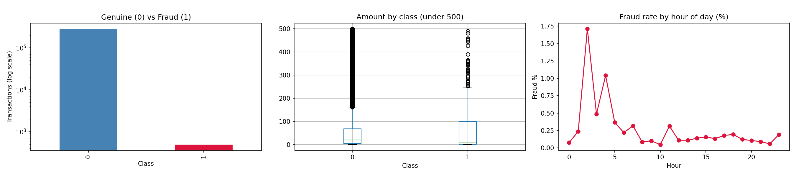
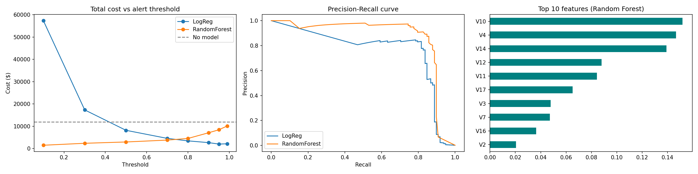

# Payment Fraud Detection: Where to Set the Alert Threshold

**Author:** YOUR NAME  |  **Tools:** SQL (SQLite), Python (pandas, scikit-learn), Excel-style KPI framework

## Summary

Fraud is 0.173% of transactions, so accuracy is a useless metric: predicting "genuine" every time scores 99.8%. The real question is economic: given a cost for missing fraud and a cost for reviewing a transaction, where should the alert threshold sit?

- A Random Forest ranks fraud better than Logistic Regression (PR-AUC **0.858** vs **0.716**).
- With the threshold chosen on a separate validation set, the model catches **87 of 98** frauds on held-out data, with **79** false alerts.
- Estimated cost falls from **$11,956** (no model) to **$1,737**, a **85.5%** reduction, under stated cost assumptions.
- The reduction holds at **78.8%-88.2%** across 9 cost scenarios.
- Main caveat: only 98 frauds in the test set. Treat every figure here as an estimate with wide error bars.

## Problem

A payment gateway loses money to fraud, but every false alert costs analyst time and risks blocking a genuine customer. Fixed rules and manual review do not scale when fraud is this rare. The decision to make: **score every transaction, review only those above a threshold.** The threshold is a business decision, not a modelling one.

## Data

[Credit Card Fraud Detection (Kaggle)](https://www.kaggle.com/datasets/mlg-ulb/creditcardfraud): 284,807 European card transactions over two days, 492 fraudulent. Features `V1`-`V28` are anonymised (PCA), plus `Time`, `Amount` and `Class`. No missing values. Raw data is not committed to this repo.

## What the Data Shows

| Finding | Number |
|---|---|
| Fraud rate | 0.173% (492 / 284,807) |
| Total fraud value | $60,128 |
| Median amount, fraud vs genuine | $9.25 vs $22.00 |
| Mean amount, fraud vs genuine | $122.21 vs $88.29 (a few large frauds pull the mean up) |
| Share of all fraud that is $1 or less | 36.8% (181 of 492) |
| Peak-hour fraud rate | 1.71% at hour 2, 1.04% at hour 4 (about 10x average) |

Fraud rate by amount is U-shaped:

| Amount | Transactions | Frauds | Fraud rate |
|---|---|---|---|
| $0-1 | 30,492 | 181 | 0.594% |
| $1-10 | 69,772 | 68 | 0.097% |
| $10-100 | 128,035 | 113 | 0.088% |
| $100-500 | 47,366 | 95 | 0.201% |
| $500+ | 9,142 | 35 | 0.383% |

The $0-1 spike is consistent with card testing, where small charges probe whether a stolen card is live. I have not verified this against transaction sequences, so it is a hypothesis. "Hour" is measured from the start of the dataset, not clock time.



## Method

1. **Split:** stratified, roughly 60% fit / 20% validation / 20% test. The test set was used once, for the final number.
2. **Preprocessing:** `Amount` scaled with RobustScaler; `Time` dropped; class imbalance handled with class weights.
3. **Models:** Logistic Regression and Random Forest, compared on PR-AUC (ROC-AUC is flattering at this imbalance: LogReg scores 0.971 with only 5.9% precision at the default threshold).
4. **Threshold:** chosen on the validation set by minimising `missed_fraud x $122 + false_alerts x $5`, then evaluated once on the test set.
5. **Sensitivity:** re-ran the threshold choice for fraud cost in {$50, $122, $300} and review cost in {$2, $5, $20}.

## Results

| Model | PR-AUC |
|---|---|
| Logistic Regression | 0.716 |
| Random Forest | **0.858** |

Held-out test set (56,962 transactions, 98 frauds), Random Forest at threshold 0.04:

| Metric | Value |
|---|---|
| Frauds caught | 87 of 98 (recall 88.8%) |
| Frauds missed | 11 |
| False alerts | 79 (0.14% of genuine) |
| Precision | 52.4% |
| Flagged for review | 0.29% of transactions |
| Estimated cost | $1,737 |
| Cost with no model | $11,956 |
| **Reduction** | **85.5%** |



### An earlier number I discarded

My first pass picked the threshold on the test set and reported $1,482 (87.6% reduction). That is optimistic, because the threshold was tuned on the data used to score it. Moving the choice to a validation set gave $1,737. The honest figure is the second one.

### Sensitivity

| Fraud cost | Review cost | Best threshold | Model cost | No-model cost | Reduction |
|---|---|---|---|---|---|
| $50 | $2 | 0.04 | $708 | $4,900 | 85.6% |
| $50 | $5 | 0.08 | $805 | $4,900 | 83.6% |
| $50 | $20 | 0.24 | $1,040 | $4,900 | 78.8% |
| $122 | $2 | 0.04 | $1,500 | $11,956 | 87.5% |
| $122 | $5 | 0.04 | $1,737 | $11,956 | 85.5% |
| $122 | $20 | 0.08 | $2,206 | $11,956 | 81.5% |
| $300 | $2 | 0.04 | $3,458 | $29,400 | 88.2% |
| $300 | $5 | 0.04 | $3,695 | $29,400 | 87.4% |
| $300 | $20 | 0.08 | $4,520 | $29,400 | 84.6% |

Full output: [`data/sensitivity_analysis.csv`](data/sensitivity_analysis.csv).

**Reading it:** the model is worth deploying in every scenario tested. The threshold moves with review cost: the more expensive a review, the higher the bar for flagging.

**Sanity check on the threshold:** if scores were calibrated probabilities, flagging is worth it when `p x $122 > $5`, i.e. `p > 0.041`. That matches the chosen 0.04. This is a consistency check only. Class-weighted Random Forest scores are not calibrated probabilities, and the match breaks down at higher review costs (breakeven 0.16 at $20 vs chosen 0.08).

## Recommendation

1. Score every transaction and route those at or above the threshold to a ranked review queue. Start near 0.04-0.08.
2. Add monitoring or a rule for transactions of $1 or less, which hold 36.8% of fraud.
3. Re-tune the threshold whenever the real cost of a missed fraud or a review changes. The threshold is the lever, so it should be configurable without retraining.
4. Track recall, precision, review volume and cost each period. See the [KPI framework](docs/kpis.md).

## Limitations

- **Small positive class.** 98 test frauds means one or two cases move recall by 1-2 points. No confidence intervals reported; they would be wide.
- **Costs are assumed.** $122 is the average fraud amount in the data; $5 per review is a guess. Sensitivity covers a range, not the truth.
- **Two days of data.** No seasonality, no drift test. Real fraud patterns shift, so any production use needs monitoring and retraining.
- **Anonymised features.** I can rank which features matter (V10, V4, V14 lead) but cannot explain them in business terms.
- **Minor preprocessing leak.** `Amount` was scaled before the split. Random Forest is insensitive to scaling, so the headline result is unaffected, but the pipeline should fit the scaler on training data only.
- **Costs are symmetric across transactions.** A missed $5,000 fraud and a missed $2 fraud are treated at the same average cost. A per-transaction cost would change the threshold.

## What I Would Do Next

- Per-transaction cost (use `Amount`) instead of a flat $122.
- Probability calibration, then re-derive the threshold from first principles.
- Bootstrap confidence intervals on recall and cost.
- Out-of-time validation, if a longer dataset is available.

## Documentation

- [Business Requirements Document](docs/BRD.md)
- [User Stories](docs/user_stories.md)
- [Process Flow (As-Is vs To-Be)](docs/process_flow.md)
- [KPI Framework](docs/kpis.md)

## Repository Structure

```
02_Payment_Fraud_Detection_FinTech/
  README.md
  docs/        BRD, user stories, process flow, KPIs
  sql/         analysis.sql (fraud rate, amount buckets, risky hours, small-value fraud)
  notebooks/   Fraud_Detection.ipynb
  images/      eda_overview.png, model_results.png
  data/        sensitivity_analysis.csv (raw data not committed)
```

## Reproduce

1. Download `creditcard.csv` from the Kaggle link above.
2. Open `notebooks/Fraud_Detection.ipynb` in Google Colab, upload the CSV, run all cells.
3. SQL queries in `sql/analysis.sql` run against the same CSV loaded into SQLite.
