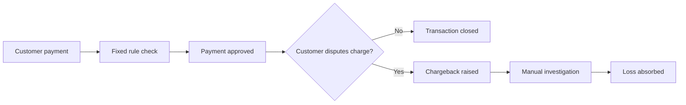
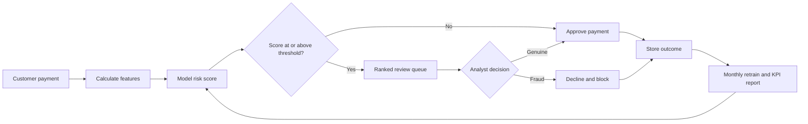

# Process Flow: Payment Fraud Detection

## As-Is
Transactions are approved using fixed rules. Most fraud is discovered later, when a customer disputes the charge. Analysts then investigate manually, and money is already lost.

**Pain points:** fraud found after the money is lost, rare fraud hidden among normal payments, investigations are slow and reactive, no ranking of risk.

## To-Be
Every transaction is scored before approval. Only high-risk transactions go to a ranked review queue, so analysts spend time where fraud is most likely. Outcomes feed back into retraining.

**Key decision points**
- **Threshold:** tested range 0.04 to 0.24 depending on costs; 0.04 recommended under the base assumptions ($122 missed fraud, $5 review)
- **Analyst decision:** confirms fraud or releases the payment
- **Feedback loop:** confirmed outcomes stored so the model can be retrained

## Expected impact (test data, under stated assumptions)
- 87 of 98 frauds caught (88.8%)
- 79 false alerts, about 0.14% of genuine transactions
- Estimated cost reduction of 85.5% ($1,737 vs $11,956)
