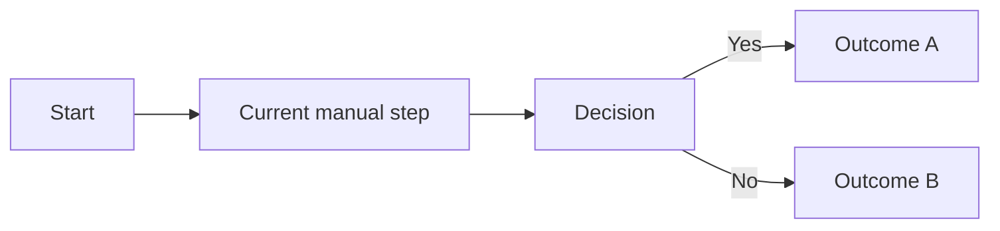
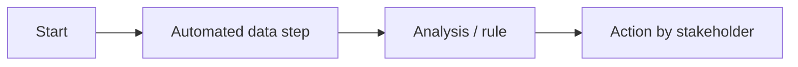

# Process Flow

## As-Is
Sales and finance track performance in separate spreadsheets with no shared view.

## To-Be
One dashboard shows revenue, margin, discounts and account health.

Edit the diagrams so they match your own process. GitHub renders them automatically.
